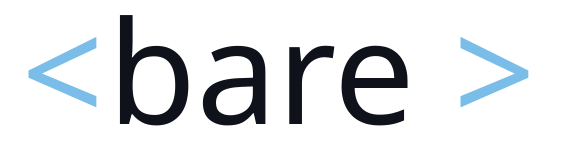

# BareReplay

<p align="center">
  <picture>
    <source media="(prefers-color-scheme: dark)" srcset="public/assets/bare_darkmode.svg">
    <source media="(prefers-color-scheme: light)" srcset="public/assets/bare_lightmode.svg">
    
  </picture>
</p>

**Time-travel replay debugger for [BareBuild](https://github.com/avanelsas/barebuild) apps.**

[](https://clojars.org/com.github.avanelsas/barereplay)

**Part of a set.** [BareDOM](https://github.com/avanelsas/baredom) is a comprehensive web component
library. [BareBuild](https://github.com/avanelsas/barebuild) is a small runtime that drives web
components from server state alone. [BareReplay](https://github.com/avanelsas/barereplay) is a
powerful time-travel replay debugger for BareBuild-based apps.
[BareProbe](https://github.com/avanelsas/bareprobe) reads the same log from a REPL.

BareReplay records the BareBuild event log and reconstructs any past state by
replaying the pure `step`, then re-projects it onto the live components. Drop it
into a BareBuild app and you get a draggable dock that scrubs, steps, and jumps
through everything the app has done, with the request and response behind each step.

## Why it is small

Every BareBuild transition is a pure function
`step : Resource × Event → Resource × [Effect]`. BareReplay leans on that. It stores
each recorded event, and the state at any position is a fold of `step` over the
events up to it. Nothing is cached and nothing mutates. A position is a value you
derive by replaying, so the debugger is almost free.

## Usage

Call `init!` before your BareBuild `init`, so the recorder is in place before the
first event.

```clojure
(ns your-app
  (:require [barereplay.init :as barereplay]
            [barebuild.core :as barebuild]))

(barereplay/init!)
(barebuild/init)
```

The dock mounts itself in the top-right corner. Move it by its handle, travel with
the transport buttons or the timeline, and open the Data pane to see each step's
request and response. The dock can be collapsed to its title bar.

## Install

deps.edn:

```clojure
com.github.avanelsas/barereplay {:mvn/version "0.5.0"}
```
